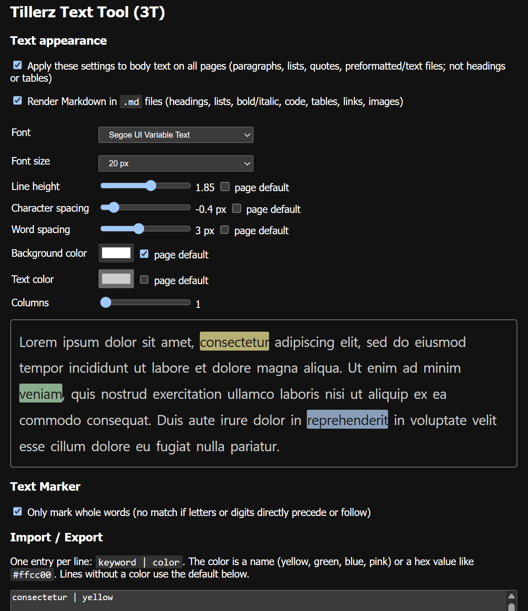

# Chrome Extensions

A collection of small Chrome extensions.

## Extensions

| Extension | Description |
| --- | --- |
| [Tillerz Text Tool (3T)](tillerz-text-tool/) | Highlights your saved keywords in pastel colors on every page, and lets you restyle body text (font, spacing, colors, columns). |

## Installing an extension

1. Open `chrome://extensions` in Chrome.
2. Enable **Developer mode**.
3. Click **Load unpacked** and select the extension's folder (for example `text-marker`).

Each extension's folder has its own README with usage details.

## License

This work is licensed under [Creative Commons Attribution-NonCommercial 4.0 International (CC BY-NC 4.0)](https://creativecommons.org/licenses/by-nc/4.0/). The full text is in [LICENSE](LICENSE).
