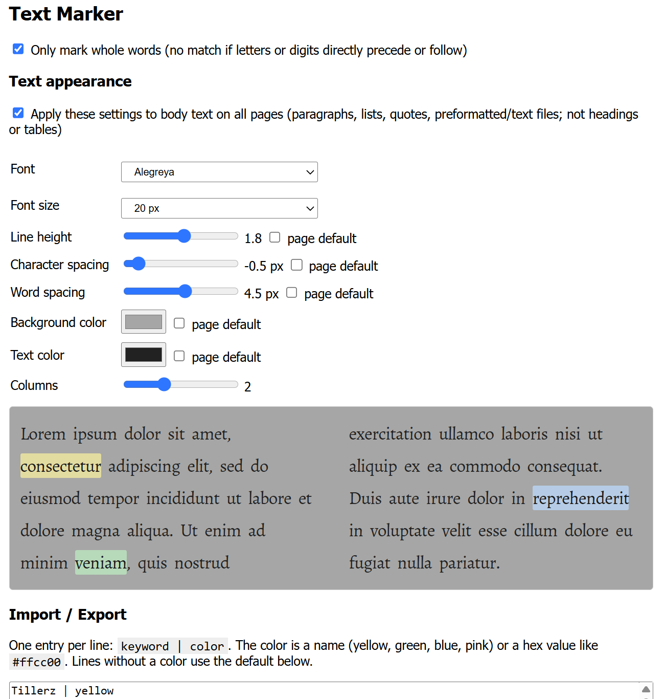

# Tillerz Text Tool (3T)

A Chrome extension (Manifest V3) that highlights your saved keywords on every page you visit. Select text, right-click, pick a color, and that text is highlighted everywhere from then on.

## Features

- Right-click selected text to **mark** it in one of several pastel colors, or **unmark** it.
- Marks are saved and highlighted on all pages, including dynamically loaded content.
- Case-insensitive matching.
- Optional **whole words only** mode.
- Hover a highlight to see how many times that word appears on the page.
- Highlight text is always dark, so it stays readable on dark-mode pages.
- Import / export of your keyword list.
- Adjustable body text appearance on all pages, with a live preview:
  - Font (from your installed fonts) and font size.
  - Line height, character spacing and word spacing.
  - Background color and text color (highlights stay visible on any background).
  - 1 to 4 columns for the whole page.
  - Works on web pages and on plain text / `.md` files.
- Toolbar button to turn the extension on and off.

## Installation

1. Download or clone this repository.
2. Open `chrome://extensions` in Chrome.
3. Enable **Developer mode** (top right).
4. Click **Load unpacked** and select the `text-marker` folder.
5. Reload any tabs that were already open.

After changing any file, click the reload icon on the extension's card in `chrome://extensions`.

## Usage

### Marking and unmarking

1. Select a word or phrase on a page.
2. Right-click and open the **Text Marker** submenu.
3. Choose one of the **mark** entries (the colored disc shows the color) or **unmark**.

Chrome groups an extension's multiple context menu items under a submenu; this can't be avoided.

Leading and trailing whitespace is removed before saving, and matching ignores upper/lower case. Multi-word phrases match across differing whitespace.

### Toolbar button

Click the extension icon to toggle highlighting on or off. When off, the badge shows `OFF`, highlights are removed, and the menu entries are hidden.

### Hover count

Hover over a highlighted word to see a tooltip such as `"example": 5 on this page`.

### Options page

Right-click the toolbar icon and choose **Options**.



- **Only mark whole words**: a keyword only matches if no letter, digit or underscore directly precedes or follows it. Off by default.
- **Text appearance**: font, font size, line height, character spacing and word spacing for body text on all pages, with a live preview. Settings are saved as you change them and apply to all open tabs immediately.
  - Affected elements: paragraphs, list items, block quotes, definition lists, figure captions and `<pre>` (so plain text and `.txt`/`.md` files are covered). Headings and tables are left alone.
  - The font list comes from your installed fonts.
  - The "Apply these settings" box must be ticked. "Page default" leaves a value untouched.
  - **Background color** and **text color**: set on the page and on the body text elements above. Highlights keep their own colors and dark text, so marked words stay visible on any background.
  - **Columns** (1 to 4) splits the whole page into columns, not just the elements above. For text documents the columns are applied to the text itself; for normal pages to the `<body>`. At 1 nothing is changed.
  - For local files, enable "Allow access to file URLs" in the extension's details on `chrome://extensions`.
- **Import / Export**: edit your list in bulk (see below).

## Import / export format

One entry per line:

```
keyword | color
```

`color` is a color name (`yellow`, `green`, `blue`, `pink`) or a hex value such as `#ffcc00`. Lines without a color use the "Default color" dropdown.

```
chrome extension | yellow
manifest | green
privacy | #ffcc00
plain keyword
```

| Button | Action |
| --- | --- |
| Import (add / overwrite) | Merges the list into existing marks; existing keywords get the new color |
| Replace all | Deletes all current marks and uses only the list in the text box |
| Load current list | Fills the text box with the saved marks |
| Download .txt | Saves the current list to a file |

## Adding colors

Add an entry to the `COLORS` list in [colors.js](colors.js):

```js
{ id: "orange", icon: "🟠", hex: "#ffd9b3" }
```

`id` must be unique. `icon` is the emoji shown in the context menu (menus can't display custom graphics). Reload the extension afterwards.

The highlight opacity (70%) can be changed in `content.js` by editing the `color-mix(...)` value.

## Where data is stored

Settings and marks are stored locally in `chrome.storage.local` (keys `marks`, `enabled`, `wholeWords`). Nothing is synced or sent anywhere, and the extension has no network access. Use the export function to back up your list.

## Limitations

- Text split across several HTML elements (for example a phrase that is partly bold) is not matched.
- Whole-word checks only see the text inside a single element.
- Text in input fields and editable areas is not highlighted.
- Text appearance settings don't reach body text that sits in plain `<div>`/`<span>` elements without a `<p>`, which is common on web apps.
- Columns can break pages with fixed headers, sidebars or full-screen layouts. Set Columns back to 1 if a page looks wrong.
- After updating the extension, reload it on `chrome://extensions` and reload open tabs, or old tabs keep running the previous version.

## License

CC BY-NC 4.0, see the [LICENSE](../LICENSE) in the repository root.

## Files

| File | Purpose |
| --- | --- |
| `manifest.json` | Extension manifest |
| `background.js` | Context menu, toolbar toggle, saving marks |
| `content.js` | Highlighting, hover tooltip, live updates |
| `colors.js` | Color definitions |
| `options.html` / `options.js` | Options page with import/export |
